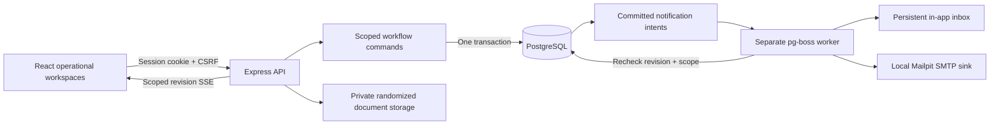
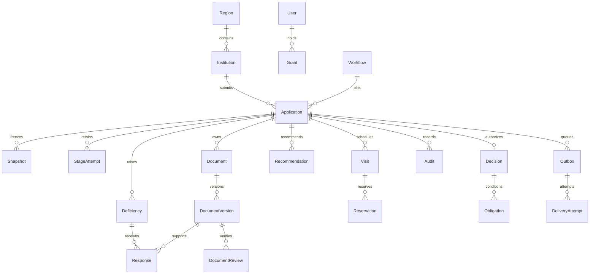
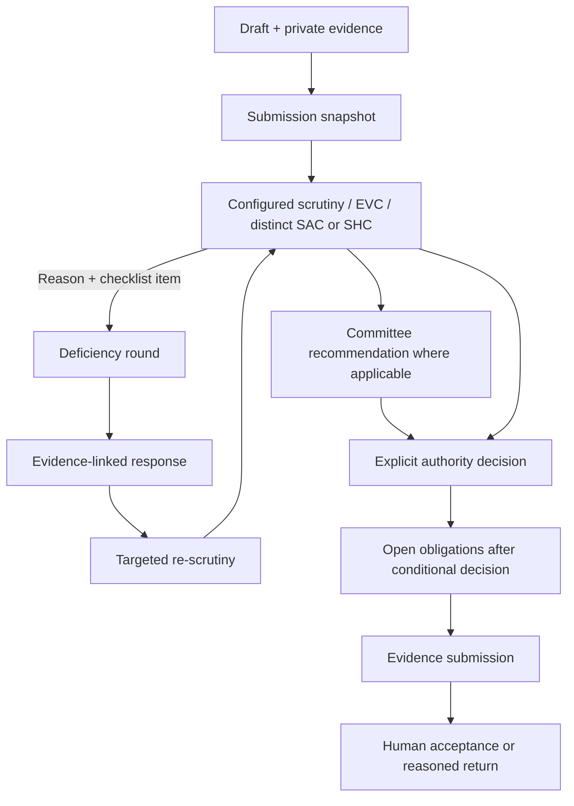

# Architecture and invariants

Anumitra is a TypeScript modular monolith with separate API and background worker processes. React/Vite is built and served from Express at the same origin. PostgreSQL is the source of truth. Private bytes are outside public assets. Fonts and Lucide icons are bundled. No runtime internet, paid inference or cloud account is needed.

Commands lock the application row, bind idempotency to actor and grants, validate expected version and allowlisted guards, preserve state/attempts, write audit and notification intent atomically. Replay can return the original result after ownership changes, while changes to grants invalidate its binding. Contradictory commands cannot both commit. Idempotency records contain transition IDs/state only, not private evidence bytes.

EVC participants take transaction-scoped advisory locks in sorted user order before checking overlapping active reservations. Every scheduling/reschedule path uses the same locks. Positive intervals are database constrained. Scheduling, reporting, recommendation and decision are separate.

The outbox is the business source of notification intent. pg-boss is its durable transport. A crash after enqueue but before acknowledging the job ID can enqueue again; row locking, terminal-state checks, deterministic keys and unique inbox records avoid reapplying business intent. SMTP acceptance cannot be exactly-once: the committed ATTEMPTED marker is explicitly treated as AMBIGUOUS on worker restart. The authorized retry UI records the reason.

Business time is persisted per current demo run. Security timestamps, queue leases and retry delays use real time. New demo runs preserve historical rows and private files while excluding old runs from active queries and superseding old jobs. Production rejects demo mode.
