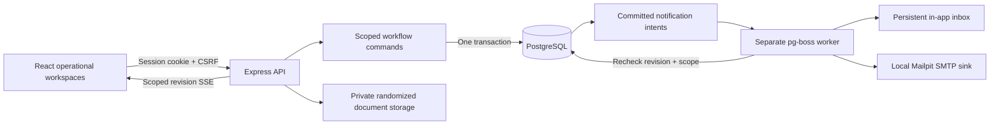
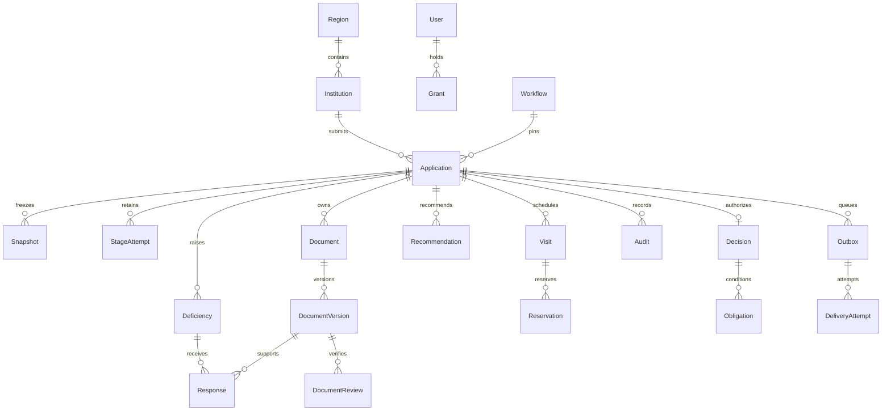
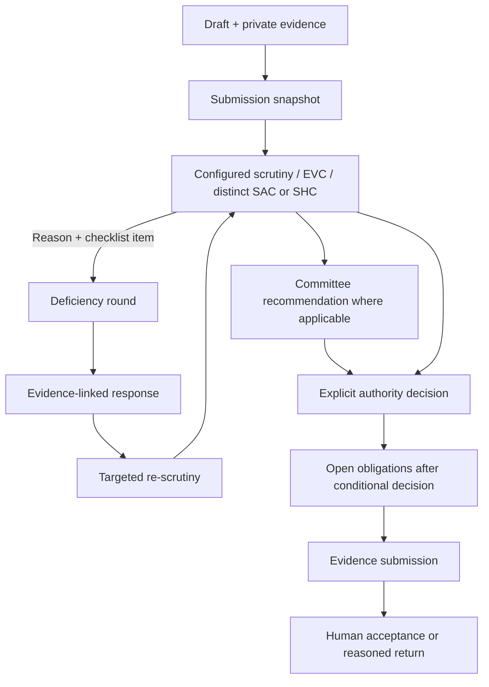

# Architecture and invariants

Anumitra is a TypeScript modular monolith with separate API and background worker processes. React/Vite is built and served from Express at the same origin. PostgreSQL is the source of truth. Private bytes are outside public assets. Fonts and Lucide icons are bundled. No runtime internet, paid inference or cloud account is needed.

Commands lock the application row, bind idempotency to actor and grants, validate expected version and allowlisted guards, preserve state/attempts, write audit and notification intent atomically. Replay can return the original result after ownership changes, while changes to grants invalidate its binding. Contradictory commands cannot both commit. Idempotency records contain transition IDs/state only, not private evidence bytes.

EVC participants take transaction-scoped advisory locks in sorted user order before checking overlapping active reservations. Every scheduling/reschedule path uses the same locks. Positive intervals are database constrained. Scheduling, reporting, recommendation and decision are separate.

The outbox is the business source of notification intent. pg-boss is its durable transport. A crash after enqueue but before acknowledging the job ID can enqueue again; row locking, terminal-state checks, deterministic keys and unique inbox records avoid reapplying business intent. SMTP acceptance cannot be exactly-once: the committed ATTEMPTED marker is explicitly treated as AMBIGUOUS on worker restart. The authorized retry UI records the reason.

Business time is persisted per current demo run. Security timestamps, queue leases and retry delays use real time. New demo runs preserve historical rows and private files while excluding old runs from active queries and superseding old jobs. Production rejects demo mode.

## Repair modules and invariants

`permissions.ts` supplies intersected grants/union scope and assignment eligibility. `attempts.ts` is the single transactional stage interval transition. Migration 005 closes legacy overlaps without inventing missing historical durations, adds a partial unique OPEN index and a PostgreSQL range exclusion constraint. Draft and terminal cases have no OPEN attempt. Legacy missing waiting durations cannot be reconstructed and remain a historical limitation.

`documents.ts` distinguishes newest submission from highest accepted effective version. A pending/rejected renewal cannot suppress accepted expired evidence. `deadlines.ts` supplies application, visit, undertaking, effective-document and missing-acceptance review subjects to scanner, dashboard and reports. Their dedicated revisions are independent of ordinary record versions. State/evidence/deadline changes invalidate queued deadline work and resolve escalation events in the same transaction; delivery rechecks current scope and subject again.

`rules.ts` locks lifecycle changes, validates saved content, checks expected revision/hash, audits saves and publishes exactly that saved version. Cases stay pinned until an explicit compatible migration, with original due time preserved and deadline identity revised. Published numeric values remain demo assumptions.

`delivery.ts` authorises a new retry generation, clears transport linkage and retains total attempt history. Worker singleton keys include generation; missing/failed/cancelled/completed transport linkage is reconciled. ATTEMPTED after restart means AMBIGUOUS, requiring duplicate-risk acknowledgement before manual retry. Inbox uniqueness is logical notification uniqueness, not exactly-once email delivery.

Uploads use private staging and per-write pending markers. Compensation checks whether a committed version references final bytes before removing them; uncertain database state retains bytes/marker for investigation. Reconciliation is dry-run by default, checks age/reference/pending markers, and refuses cleanup when referenced bytes are missing. No destructive directory cleanup runs in verification.

Runtime provisioning installs queue DDL with the owner, grants restricted service operation, and preserves existing passwords. Compose uses the same bootstrap; its engine execution remains unverified. Doctor reports database/schema/storage separately from SMTP and a fresh worker heartbeat. CI and local verification use explicitly named disposable databases and independent private directories.

A new stage/wait attempt receives its own configured calendar-day window from the business clock. Institutional response time continues under RESPONSE; it does not count as official processing time. Assignment/notes do not reset a deadline. Visit confirmation switches from scheduling to report due time with a new visit revision. Reasoned appointment cancellation releases reservations, resolves visit work and restores EVC scheduling monitoring under a new case deadline revision while preserving the original due time. No holiday or discretionary pause calendar is implemented.

Document review decisions are append-only and one decision per immutable version; corrections require a new upload. A rejected replacement leaves the prior effective expiry and escalation active. An accepted replacement closes only the superseded effective deadline and missing-acceptance work, atomically. A new submission revises only its no-accepted-evidence review subject, preserving any effective expiry. New upload timestamps use the business clock for that review SLA; authentication, audit storage timestamps, queue leases and SMTP attempts remain real time. Policy migration retires all queued old-policy subjects in the same transaction, while preserving the application's due time and immutable prior policy pin history.
