# Operational visual review — 30 October 2026

Baseline: `22afb3a4c89c7e3ad658296632a98a1eb8880b48`. Current after images: fully verified source `14002e4e79b0d865f3c6715419c9ba61c405e44c`. These are actual isolated-browser captures with fictional operational records, not mockups. Published public facts appear only in their separate historical reference workspace.

## Action desk

Role-specific tasks, transparent urgency, real counts, 25-task paging and workload drilldowns.

| Before | After |
|---|---|
| 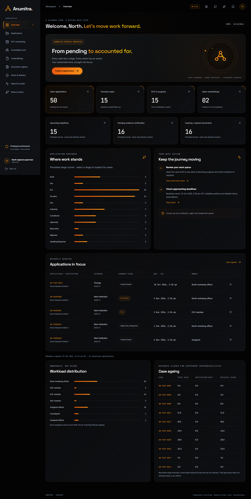 | 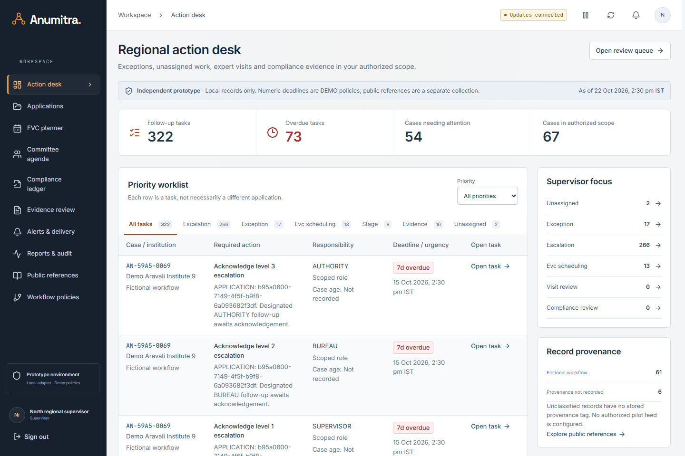 |

## Applications

Compact filters/chips, server pagination/sorting, next responsibility and deadline subject.

| Before | After |
|---|---|
| 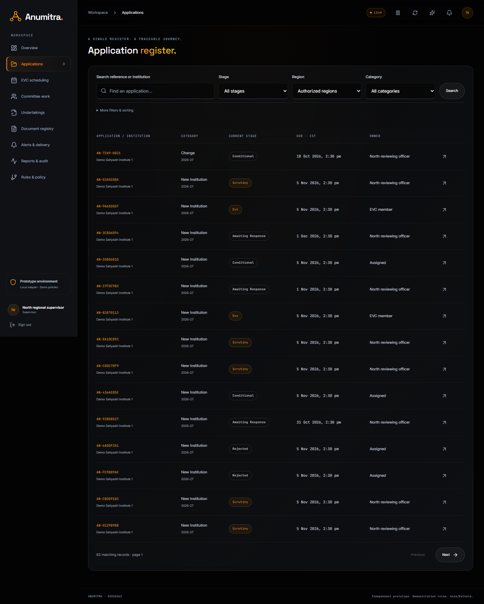 | 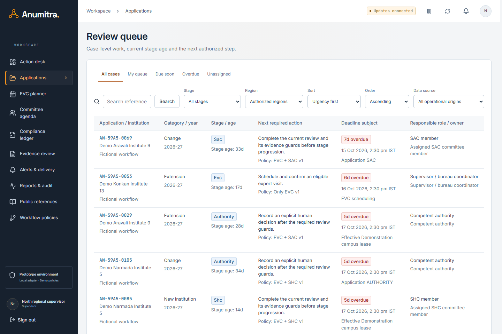 |

## Case review

Evidence-first review, compact progression and distinct guarded tasks.

| Before | After |
|---|---|
| 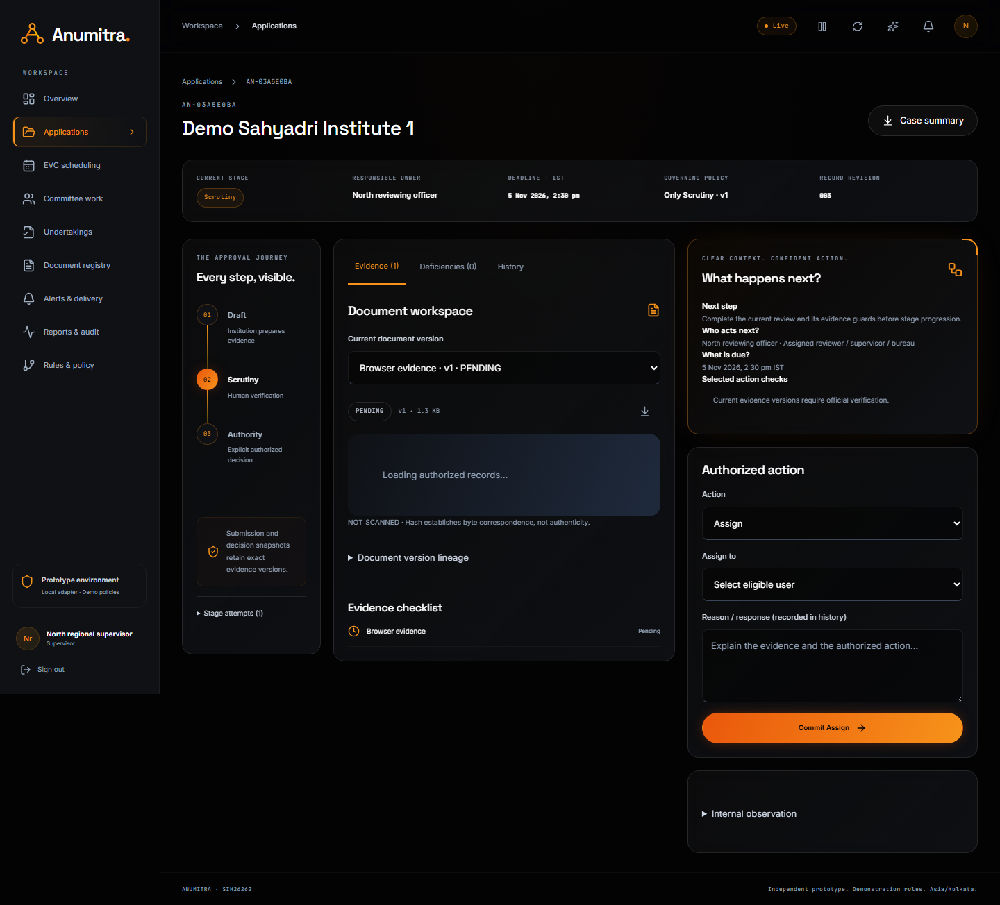 | 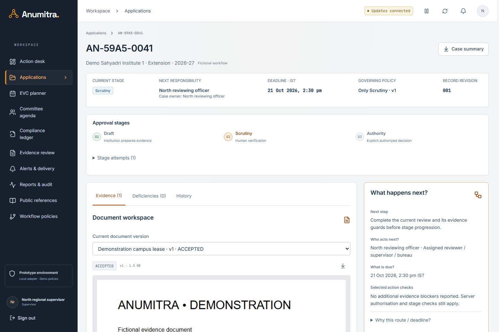 |

## Committee

Assigned-case readiness, selected agenda, recommendation history and separate completion.

| Before | After |
|---|---|
| 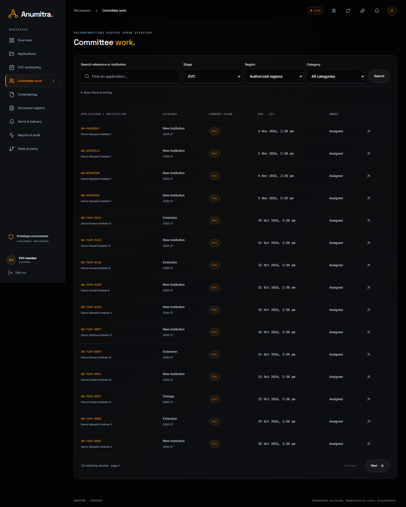 | 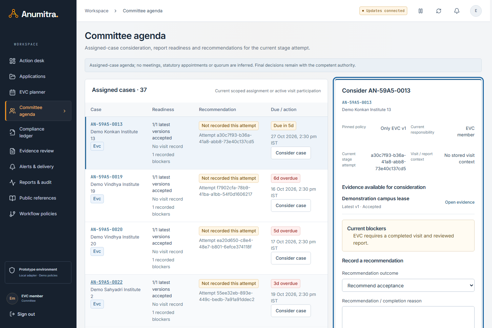 |

## EVC

IST week/accessible agenda, real eligibility, availability and appointment details.

| Before | After |
|---|---|
| 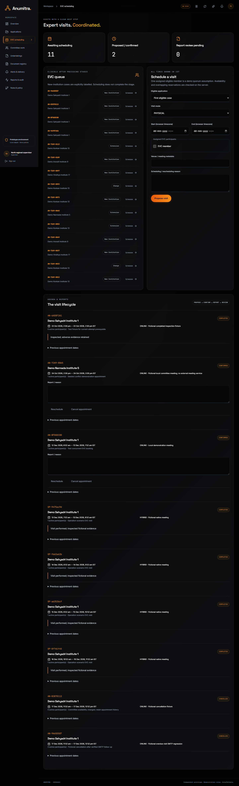 | 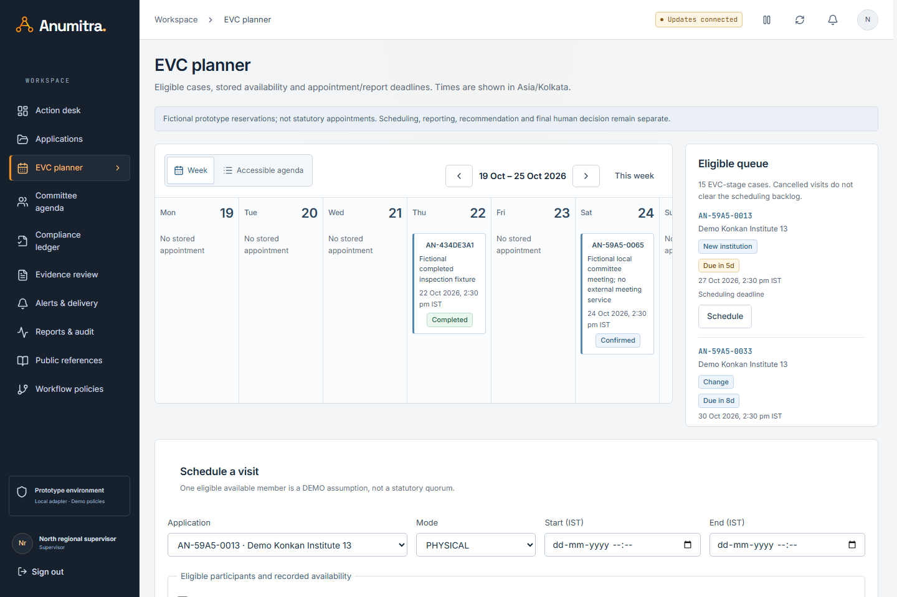 |

## Documents

Compact register with selected effective/latest evidence and authorized review.

| Before | After |
|---|---|
|  | 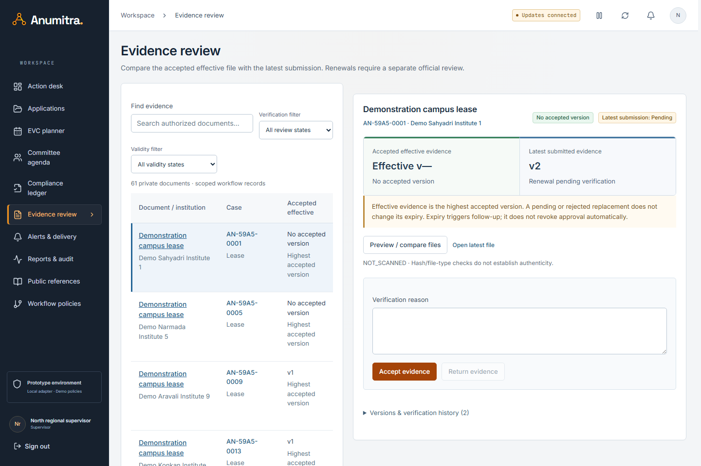 |

## Rules

Read-only published policy, keyboard stage ordering and real guard simulation.

| Before | After |
|---|---|
| 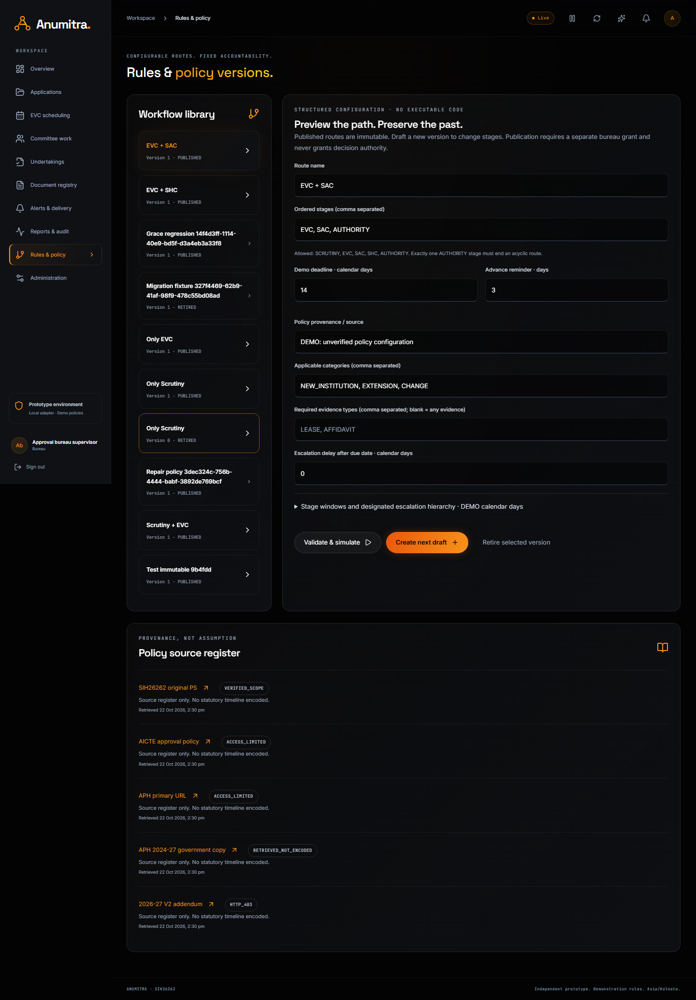 | 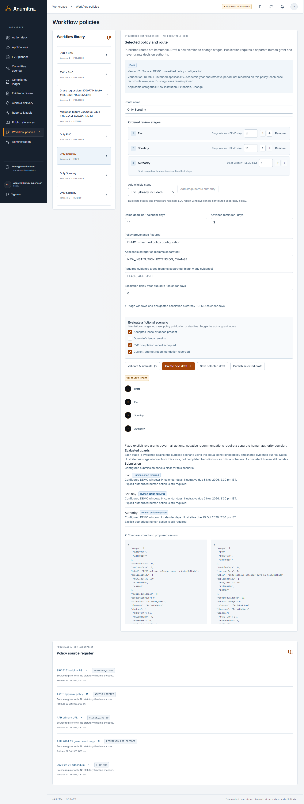 |

Additional proof: [recommendation-ready committee case](evidence/operations-2026-10-30/full-3/operations/committee-recommendation-ready.png), [human decision packet](evidence/operations-2026-10-30/full-3/operations/authority-decision-packet.png), [submitted undertaking](evidence/operations-2026-10-30/full-3/operations/undertaking-submitted.png), [accepted undertaking](evidence/operations-2026-10-30/full-3/operations/undertaking-accepted.png), [rejected renewal preserves effective v1](evidence/operations-2026-10-30/full-3/operations/rejected-renewal-preserves-effective-v1.png), [200% CSS enlargement](evidence/operations-2026-10-30/full-3/operations/applications-200-percent-css-zoom.png), [source-linked public references](evidence/operations-2026-10-30/full-3/operations/public-references.png). See the dated test report for exact assertions and accessibility limits.
